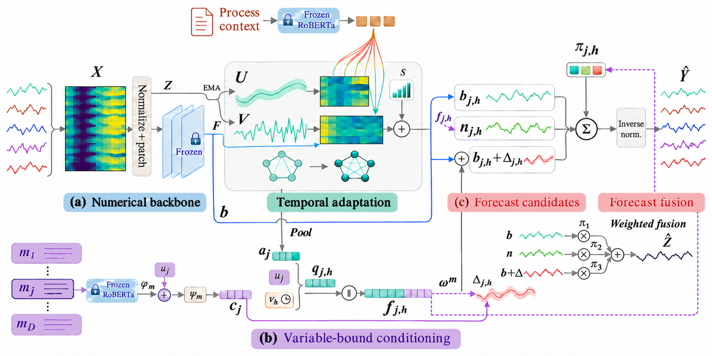

# VarBridge

**VarBridge: Bridging Process Dynamics and Variable-Specific Mechanistic Semantics for Bioprocess Forecasting**

Information Fusion · Under review

[Project page](https://joss0623.github.io/projects/varbridge/) · [Research homepage](https://joss0623.github.io/)

[Paper](paper/manuscript.pdf)

## Overview

Bind each process variable to its mechanistic description and combine this semantics with historical state, variable identity, and forecast step through hierarchical expert fusion.



## Research focus

- Variable-specific semantics
- Hierarchical fusion
- Bioprocess forecasting

## Implementation

The `code/` directory contains the available research implementation snapshot. Main entry points:

- [`code/models/KIBR_PatchTST_BoundMechanism.py`](code/models/KIBR_PatchTST_BoundMechanism.py)
- [`code/scripts/run_efp_bound_mechanisms.py`](code/scripts/run_efp_bound_mechanisms.py)
- [`code/scripts/run_cho_bound_mechanisms.py`](code/scripts/run_cho_bound_mechanisms.py)

Framework modules, dataset readers, and supporting experiments are kept with the model. Prepare the required datasets and pretrained language-model weights separately; these are not bundled with the code. Dataset locations and experiment defaults in the original scripts need to be set for your environment.

Install PyTorch for your hardware, then install the recorded dependencies:

```bash
cd code
pip install -r requirements.txt
```

Inspect the available training arguments before configuring your dataset:

```bash
cd code
python run.py --help
```

## Snapshot and verification

`release-manifest.json` records the SHA-256 of each released source file. This release was checked for Python syntax and obvious embedded credentials; it has not been retrained or certified to reproduce every paper table on a new machine.

## Acknowledgments and license

The implementation builds on existing forecasting research libraries. Original license notices are retained inside `code/`. Upstream sources include [Time-Series-Library](https://github.com/thuml/Time-Series-Library) and [AutoTimes](https://github.com/thuml/AutoTimes). The paper and figures retain their respective authors' rights.
